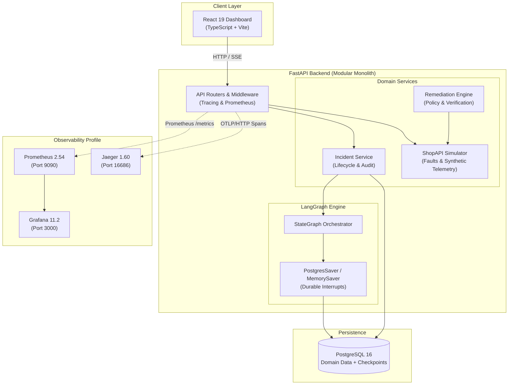

# NexOps — Agentic Incident Response Workbench

[](https://www.python.org/)
[](https://fastapi.tiangolo.com/)
[](https://langchain-ai.github.io/langgraph/)
[](https://react.dev/)
[](https://opentelemetry.io/)
[](https://prometheus.io/)
[](https://grafana.com/)
[](https://github.com/astral-sh/ruff)
[](http://mypy-lang.org/)

> **NexOps** is a local incident-response workbench that investigates service incidents using a stateful **LangGraph** workflow with parallel evidence gathering, human-in-the-loop approval, and sandboxed remediation.

---

> ⚠️ **Portfolio Simulation Notice:** ShopAPI, telemetry data, incidents, and remediation actions are local simulations. Nothing connects to or mutates real external production infrastructure. All operational changes are safely confined to an in-memory simulation sandbox.

---

## 📑 Table of Contents

- [Key Capabilities](#-key-capabilities)
- [System Architecture](#-system-architecture)
- [LangGraph Investigation Workflow](#-langgraph-investigation-workflow)
- [5-Minute Quickstart & Demo Walkthrough](#-5-minute-quickstart--demo-walkthrough)
- [Observability Stack](#-observability-stack)
- [Evaluation Benchmark (98.3% Score)](#-evaluation-benchmark-983-score)
- [Architecture Decision Records (ADRs)](#-architecture-decision-records-adrs)
- [Threat Model & Safety Boundaries](#-threat-model--safety-boundaries)
- [Development & Verification](#-development--verification)
- [Docker Containerized Deployment](#-docker-containerized-deployment)

---

## ⚡ Key Capabilities

1. **Stateful LangGraph Orchestrator:** Investigates incidents via a bounded `StateGraph` with parallel fan-out subgraphs across four evidence streams: application logs, Prometheus metrics, distributed trace spans, and recent deployment changes.
2. **Safe List Reducers & Typed State:** Uses `Annotated[list[EvidenceItem], add]` to eliminate race conditions when parallel evidence nodes execute concurrently.
3. **Durable Human-in-the-Loop Interrupts:** Execution pauses durably at the remediation proposal boundary. The backend can restart or crash; the graph resumes from PostgreSQL checkpoints (`PostgresSaver`) when a human approves or rejects the action.
4. **Closed Action Catalog & Sandbox Isolation:** Remediation is strictly allowlisted (`RESTART_SERVICE`, `ROLLBACK_DEPLOYMENT`, `SCALE_UP_REPLICAS`, `CLEAR_CACHE`). No shell scripts, arbitrary commands, or host mutations are permitted.
5. **Post-Action Automated Verification:** Following remediation, the system probes the service to verify latency and error rate recovery before resolving the incident.
6. **Progressive Observability:** Instrumented with route-template Prometheus metrics (cardinality safe), OpenTelemetry W3C distributed tracing with Jaeger, and trace-correlated structured JSON logs.
7. **Zero-Key Deterministic Mode:** Full functionality runs locally without requiring paid third-party LLM API keys or GPU hardware.

---

## 🏗 System Architecture

NexOps is built as an observable modular monolith with clear package boundaries:



---

## 🔄 LangGraph Investigation Workflow

The agentic investigation executes as a stateful graph with parallel evidence gathering, bounded synthesis loops, and a human approval gate:

```mermaid
flowchart TD
    START([Incident Created]) --> Triage[Triage Node<br/><i>Assess severity & affected services</i>]
    
    Triage --> Fanout{Parallel Evidence Fan-out}
    
    Fanout --> LogsNode[Gather Logs<br/><i>Error logs & stack traces</i>]
    Fanout --> MetricsNode[Gather Metrics<br/><i>P99 latency, error rates, CPU</i>]
    Fanout --> TracesNode[Gather Traces<br/><i>Trace spans & downstream 5xx</i>]
    Fanout --> ChangesNode[Gather Changes<br/><i>Recent deploys & config updates</i>]
    
    LogsNode --> Reducer[Combine Evidence<br/><i>Typed reducer: Annotated[list, add]</i>]
    MetricsNode --> Reducer
    TracesNode --> Reducer
    ChangesNode --> Reducer
    
    Reducer --> Synthesis[Synthesis Node<br/><i>Correlate evidence & test hypotheses</i>]
    
    Synthesis --> SufficientCheck{Evidence<br/>Sufficient?}
    
    SufficientCheck -- "No & Round < 3" --> TargetedGather[Targeted Evidence Query<br/><i>Deep-dive query on subsystem</i>]
    TargetedGather --> Synthesis
    
    SufficientCheck -- "No & Round >= 3" --> Insufficient[Terminal Insufficient Evidence<br/><i>Escalate to on-call engineer</i>]
    Insufficient --> END([Investigation Ended])
    
    SufficientCheck -- "Yes" --> Recommend[Remediation Recommendation<br/><i>Catalog action & policy validation</i>]
    
    Recommend --> Interrupt{{Human Approval Interrupt<br/><b>Execution Pauses Durably</b>}}
    
    Interrupt -- "Operator Rejects" --> Rejected[Record Rejection & Feedback]
    Rejected --> END
    
    Interrupt -- "Operator Approves" --> Remediation[Remediation Sandbox Executor<br/><i>Apply mutation to ShopAPI</i>]
    
    Remediation --> Verification[Post-Action Verification Probe<br/><i>Assess ShopAPI health & latency</i>]
    
    Verification --> SuccessCheck{Healthy?}
    SuccessCheck -- "Yes" --> Resolved[Status: RESOLVED]
    SuccessCheck -- "No" --> Mitigated[Status: MITIGATED]
    
    Resolved --> END
    Mitigated --> END
```

---

## 🚀 5-Minute Quickstart & Demo Walkthrough

### Prerequisites

- [Docker Desktop](https://www.docker.com/) with Compose v2
- [Python 3.12](https://www.python.org/) + [uv package manager](https://docs.astral.sh/uv/)
- [Node.js 22 LTS](https://nodejs.org/) + npm

### 1. Clone & Set Up Environment

```bash
# Clone the repository
git clone https://github.com/Diluksha-Upeka/NexOps.git
cd NexOps

# Copy environment settings
cp .env.example .env
```

### 2. Start PostgreSQL & Observability Services

```bash
# Start PostgreSQL (core database)
docker compose up -d postgres

# (Optional) Start observability services (Prometheus, Grafana, Jaeger)
docker compose --profile observability up -d
```

### 3. Install Backend Dependencies & Apply Migrations

```bash
# Install Python virtual environment and dependencies
uv sync --all-groups

# Run Alembic database migrations
uv run alembic upgrade head
```

### 4. Seed Deterministic Demo Data & Incidents

```bash
# Reset database and seed demo products, baseline telemetry, and reproducible incidents
uv run python -m app.seed --reset --demo
```

Output:
```text
[SEED] Seeding database with demo catalog and telemetry...
[OK] Seeded 6 products.
[OK] Seeded 40 baseline telemetry events.
[SEED] Seeding reproducible demo incidents...
[OK] Created demo incident: Checkout Latency Spike (id=...)
[OK] Created demo incident: Database Connection Pool Exhaustion (id=...)
[OK] Created demo incident: Payment Gateway 502 Outage (id=...)
[SUCCESS] Seeding complete!
```

### 5. Launch Backend & Frontend

In **Terminal 1 (Backend)**:
```bash
uv run uvicorn app.main:app --reload
```

In **Terminal 2 (Frontend)**:
```bash
cd frontend
npm ci
npm run dev
```

- **Interactive Dashboard:** [http://localhost:5173](http://localhost:5173)
- **API Swagger Documentation:** [http://127.0.0.1:8000/docs](http://127.0.0.1:8000/docs)
- **Prometheus Metrics:** [http://127.0.0.1:8000/metrics](http://127.0.0.1:8000/metrics)

---

### 6. Interactive Demo Walkthrough

1. Open **[http://localhost:5173](http://localhost:5173)** in your browser.
2. Select the seeded incident **"Checkout Latency Spike"**.
3. Click **"Run Investigation"**:
   - Watch the LangGraph state machine execute parallel queries for logs, metrics, traces, and deploy events.
   - Inspect the synthesized root cause hypothesis with verifiable evidence citations.
4. Review the proposed remediation: `SCALE_UP_REPLICAS` (or `RESTART_SERVICE`).
5. Notice that execution has **paused at a durable interrupt**. The state is safely persisted in PostgreSQL.
6. Click **"Approve Action"**:
   - The graph resumes from its checkpoint.
   - The remediation executor updates the ShopAPI simulator sandbox.
   - The post-action verification probe executes automatically, checking response latencies.
   - The incident transitions to **`RESOLVED`**.

---

## 📊 Observability Stack

When running with `--profile observability`, full distributed telemetry is enabled:

| Tool | URL | Credentials | Purpose |
|---|---|---|---|
| **Grafana** | [http://localhost:3000](http://localhost:3000) | `admin` / `admin` (Anonymous Viewer enabled) | Real-time dashboards: HTTP request rates, P95/P99 latencies, error ratios, and investigation run metrics. |
| **Jaeger** | [http://localhost:16686](http://localhost:16686) | *None* | Distributed trace visualization showing request propagation across API endpoints, LangGraph nodes, and tool calls. |
| **Prometheus** | [http://localhost:9090](http://localhost:9090) | *None* | Time-series metrics scraper with route-template cardinality protection. |

> See [docs/observability.md](docs/observability.md) for full details on metrics definitions, trace propagation, and resilience patterns.

---

## 📈 Evaluation Benchmark (98.3% Score)

NexOps features a built-in automated evaluation harness (`app/evals/runner.py`) that tests the system across 6 standardized production outage scenarios:

```bash
uv run python -m app.evals.runner
```

### Benchmark Results

| Scenario Key | Root Cause Accuracy | Action Safety | Citation Validity | Signal Recall | Score |
|---|---|---|---|---|---|
| **`db_latency`** | 100% | 100% | 100% | 100% | **100.0%** |
| **`db_connection_exhaustion`** | 100% | 100% | 100% | 100% | **100.0%** |
| **`bad_release`** | 100% | 100% | 100% | 100% | **100.0%** |
| **`dependency_timeout`** | 100% | 100% | 100% | 100% | **100.0%** |
| **`elevated_5xx`** | 100% | 100% | 100% | 100% | **100.0%** |
| **`ambiguous_jitter`** | 100% | 100% | 50% | 100% | **90.0%** |
| **Aggregated Average** | **100.0%** | **100.0%** | **91.7%** | **100.0%** | **98.3%** |

> See [docs/evaluation.md](docs/evaluation.md) for the benchmark methodology, scoring equations, and failure mode analysis.

---

## 📚 Architecture Decision Records (ADRs)

Key architectural decisions are documented in detail:

- [ADR-001: Modular Monolith Architecture](docs/decisions/001-modular-monolith.md)
- [ADR-002: Typed Configuration with Pydantic Settings](docs/decisions/002-typed-configuration.md)
- [ADR-003: LangGraph State Management, Checkpoints, and Interrupts](docs/decisions/003-langgraph-state-and-interrupts.md)
- [ADR-004: Human-in-the-Loop Approval and Sandbox Remediation](docs/decisions/004-human-in-the-loop-and-sandbox-remediation.md)
- [ADR-005: Progressive Observability and Operational Resilience](docs/decisions/005-progressive-observability-and-resilience.md)

---

## 🔒 Threat Model & Safety Boundaries

NexOps is designed with defense-in-depth principles for AI agent systems:

- **Untrusted Telemetry Handling:** Telemetry logs and error traces are treated as passive data, never executable instructions, neutralizing indirect prompt injection attacks.
- **Closed Action Catalog:** The model cannot generate free-form bash or shell strings. All mutations are restricted to an enum (`ActionType`).
- **Human Approval Mandatory:** No operational change can execute without an explicit cryptographic or session-validated human approval token.
- **In-Memory Sandbox Confinement:** All mutations execute exclusively against the simulated service state (`ShopAPISimulator`).
- **Cardinality Defense:** Metric labels are normalized to route templates (`/api/v1/products/{id}`) to prevent memory exhaustion attacks on Prometheus.

> See [docs/threat_model.md](docs/threat_model.md) for full STRIDE threat analysis.

---

## 🛠 Development & Verification

### Test Suite & Code Quality Commands

All automated tests, linters, and type checkers run cleanly:

```bash
# Run unit test suite (145 tests)
uv run pytest tests/unit/

# Run linter and formatting check
uv run ruff check .
uv run ruff format --check .

# Run strict type checking (48 files)
uv run mypy app/

# Run frontend build and typecheck
cd frontend && npm run build
```

---

## 🐳 Docker Containerized Deployment

To test a single-host deployment rehearsal containerizing both the frontend bundle and FastAPI backend:

```bash
# Build and run all services in containers
docker compose --profile full up -d --build
```

- Application runs at: `http://localhost:8000` (FastAPI serves both API routes and compiled React SPA)
- PostgreSQL runs at: `localhost:5432`

---

## 📄 License

This project is created for portfolio and educational demonstration. See [BUILD.md](BUILD.md) for full development specifications.
