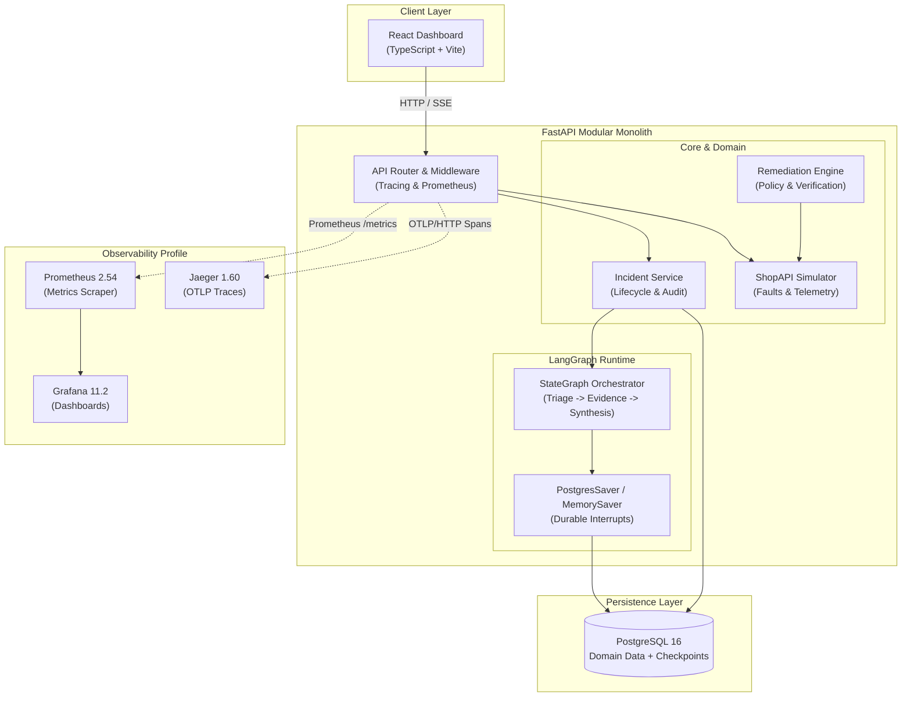
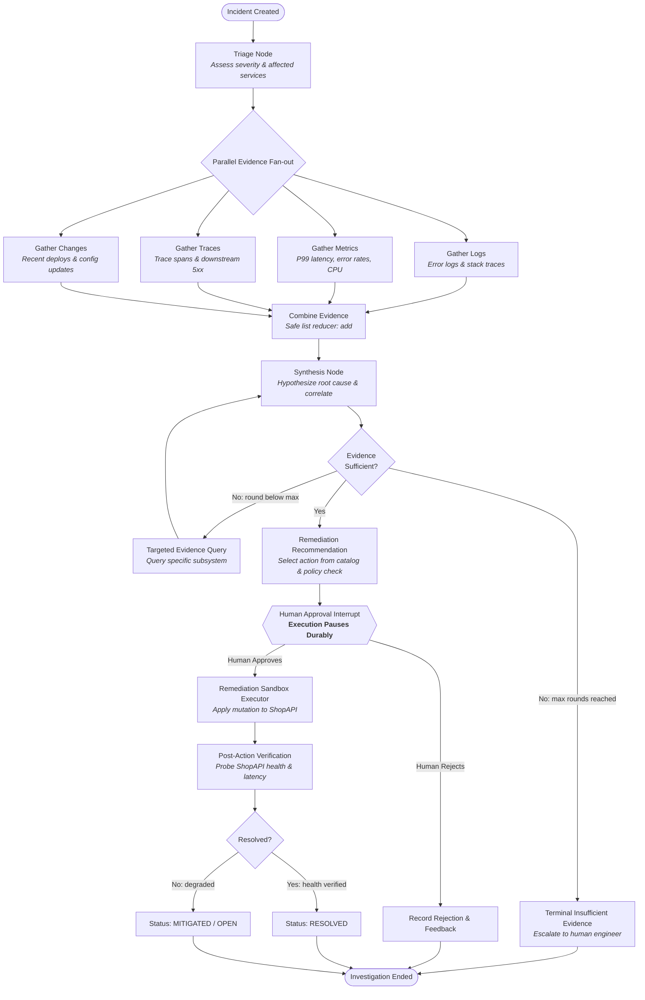

# Architecture Overview

> **NexOps** is a local incident-response workbench that investigates simulated service incidents using a LangGraph workflow with human-in-the-loop approval.

⚠️ **Local Simulation Notice:** ShopAPI, telemetry data, incidents, and remediation actions are local simulations. Nothing connects to or mutates real external production infrastructure.

---

## 1. System Architecture

NexOps is architected as an observable **modular monolith**: a single FastAPI backend, an interactive React frontend, a PostgreSQL database for domain models and workflow checkpoints, and an optional observability sidecar stack (Prometheus, Grafana, Jaeger).

---

## 2. LangGraph Investigation Workflow

The core reasoning engine is implemented as a bounded, stateful **LangGraph `StateGraph`**. It decomposes the investigation into parallel evidence gathering, synthesis, sufficiency evaluation, human approval interrupts, and sandboxed remediation.

---

## 3. Key Design Principles & Boundaries

### 3.1 State Management & Reducers
The graph state is defined by a strict Pydantic model (`IncidentState`):
- `evidence`: Annotated with `add` reducer (`Annotated[list[EvidenceItem], add]`). When parallel nodes (`gather_logs`, `gather_metrics`, `gather_traces`, `gather_changes`) execute concurrently, their findings append safely to the accumulator list without race conditions or list clobbering.
- `iteration`: Integer loop counter incremented on every synthesis pass to guarantee the graph cannot cycle infinitely (bounded at `max_rounds = 3`).
- `error_envelopes`: Node execution errors are captured within the state rather than raising unhandled exceptions, enabling graceful degradation.

### 3.2 Durable Human-in-the-Loop Interrupts
Operational changes require an explicit human decision. LangGraph's interrupt mechanism (`NodeInterrupt`) serializes the full investigation state to PostgreSQL (`PostgresSaver`).
- The API worker or container can restart or reload during this window without losing context.
- Once an operator reviews the proposed action and sends `POST /api/v1/incidents/{id}/approve` or `POST /api/v1/incidents/{id}/reject`, the orchestrator loads the checkpoint and resumes execution at the exact interrupted node.

### 3.3 Sandboxed Remediation
- **Closed Action Catalog:** Actions are strictly bounded to an allowlisted enum:
  - `RESTART_SERVICE`
  - `ROLLBACK_DEPLOYMENT`
  - `SCALE_UP_REPLICAS`
  - `CLEAR_CACHE`
- **Zero OS/Host Mutation:** The remediation engine communicates exclusively with `ShopAPISimulator`. It alters simulated failure state, restarts mock components, or resets mock cache TTLs. No shell commands or real cloud APIs are ever invoked.
- **Verification Loop:** Following remediation, the system executes an automated verification probe against ShopAPI to assess whether error rates and response latencies returned to baseline before closing the incident.

### 3.4 Progressive Observability
- **Prometheus Metrics:** Low-cardinality endpoint tracking via route templates (`/api/v1/products/{id}`).
- **OpenTelemetry Tracing:** Standard W3C `traceparent` propagation connecting HTTP requests, graph execution spans, and tool calls.
- **Correlated Logging:** JSON-formatted logs enriched with `trace_id` and `span_id`.

---

## 4. Key Module Boundaries

| Package | Responsibility |
|---|---|
| `app/api/` | HTTP request handling, response schemas, error formatting, CORS |
| `app/core/` | Pydantic settings, structured logging, resilience primitives |
| `app/db/` | SQLAlchemy engine, session lifecycle, domain models, Alembic migrations |
| `app/shopapi/` | Simulated e-commerce service, fault injector, telemetry generator |
| `app/incidents/` | Incident domain entity lifecycle, audit logs, REST routes |
| `app/graph/` | LangGraph StateGraph, nodes, edges, subgraphs, tools, checkpointer |
| `app/remediation/` | Action catalog, policy validator, sandbox executor, verification probe |
| `app/observability/` | Prometheus middleware, OTel tracing setup, resilience backoff |
| `app/evals/` | Deterministic benchmark runner and scenario evaluation harness |
| `frontend/` | React 18, TypeScript, Tailwind/modern CSS dashboard |

---

## 5. Architectural Decision Records (ADRs)

For deep-dive rationales behind key architectural decisions, see:
- [ADR-001: Modular Monolith Architecture](decisions/001-modular-monolith.md)
- [ADR-002: Typed Configuration with Pydantic Settings](decisions/002-typed-configuration.md)
- [ADR-003: LangGraph State Management, Checkpoints, and Interrupts](decisions/003-langgraph-state-and-interrupts.md)
- [ADR-004: Human-in-the-Loop Approval and Sandbox Remediation](decisions/004-human-in-the-loop-and-sandbox-remediation.md)
- [ADR-005: Progressive Observability and Operational Resilience](decisions/005-progressive-observability-and-resilience.md)
